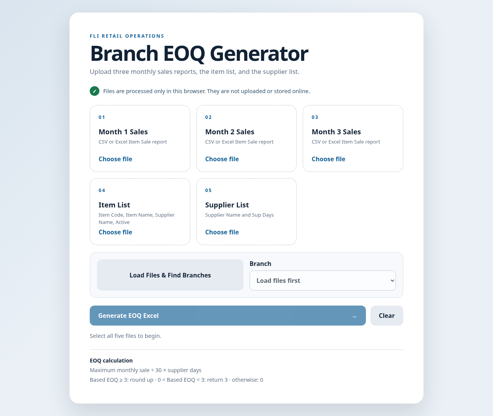
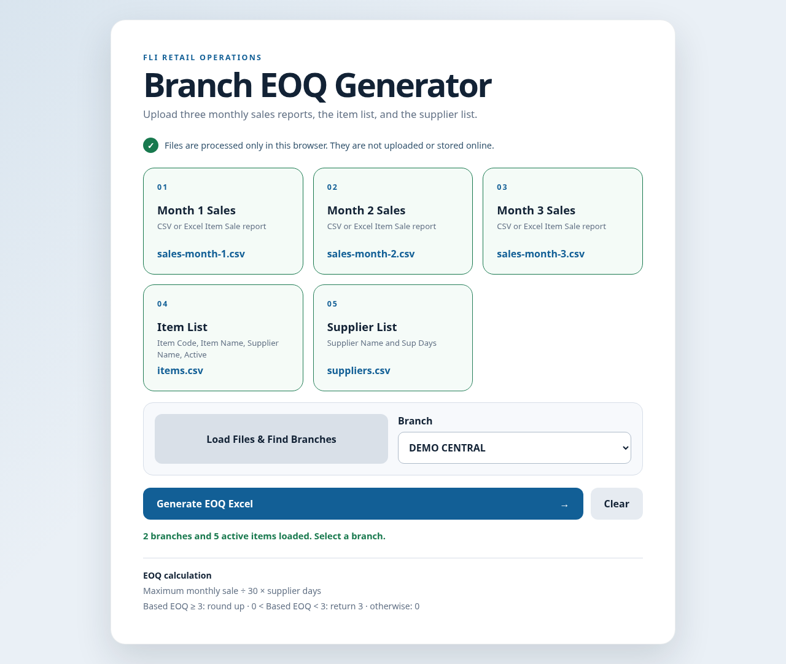
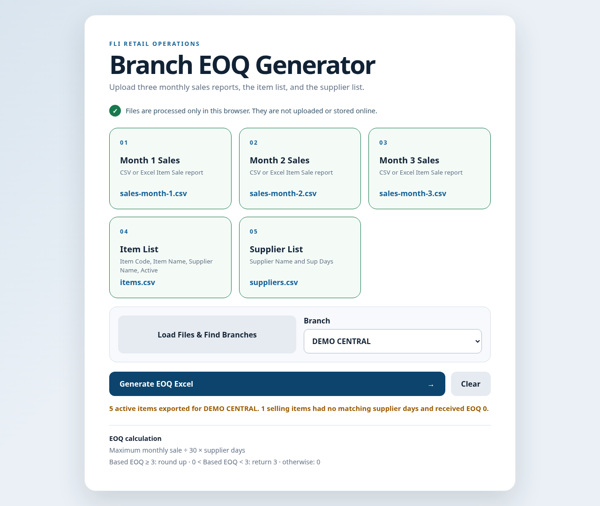

# From ERP sales to branch order quantities

**A supermarket replenishment case study by Hareendranatha Muthukumarana · Business Analyst**

A branch buyer needs to answer a practical question before a supplier delivery: **how many units of each active item should this branch plan for?** At FLI Trading, the information for that decision sits in five ERP exports. I specified how those reports fit together and used ChatGPT to turn the ordering policy into a browser tool. A branch user supplies the files, picks an outlet and downloads a four-column Excel report.

[Open the FLI Branch EOQ Generator](https://fli-branch-eoq-generator.flibateam.chatgpt.site) · [Inspect the calculation code](site/app.js) · [See a generated workbook](demo/outputs/DEMO%20CENTRAL.xlsx)

## One item, from sale to recommendation

In the included example, Demo Central sells **90, 120 and 105 units of rice** in three successive months. Month 2 contains two sales rows, 70 and 50. The tool adds them before comparing months. The peak month gives **120 ÷ 30 = 4 units per day**. The supplier's delivery period is seven days, so the workbook recommends **28 units**. Demo North uses the same item and supplier but has a peak month of 30 units. Its recommendation is **7 units**.

This is a demand-coverage rule. The site uses “EOQ” as the business label for its result. Classical economic order quantity requires ordering and holding costs. This tool uses sales and supplier days, and a buyer still needs to consider stock on hand and open orders before placing a purchase order. A promotion in the peak month can also raise the recommendation for subsequent periods.

## How the site makes the decision

| Step | Business rule |
| --- | --- |
| 1. Read five exports | Read three monthly sales files, one item master and one supplier list. Each sales file represents a separate month. CSV, XLSX and XLSM are supported. Excel inputs use the first worksheet. |
| 2. Define the item list | Retain item master records with Active equal to 1. Use item code to connect sales to items and supplier name to look up delivery days. |
| 3. Measure branch demand | For each active item, sum signed quantities separately in each month for the selected branch. A missing monthly total counts as zero. Take the highest monthly total, with a floor of zero. |
| 4. Convert demand to units | Divide the peak total by 30 and multiply by supplier days. Keep full precision until the final step. |
| 5. Apply the order policy | Zero demand or zero supplier days gives 0 units. A positive result below 3 gives 3 units. At 3 or higher, round up to the next whole unit when needed. |
| 6. Export for review | Write Item Code, Item Name, Supplier and EOQ for every active item to a branch-named workbook. A selling item with an unmatched supplier receives 0 and contributes to the on-screen warning count. |

## Try the same decision yourself

1. Download the repository and extract it. Open the live site above, or double-click **site/index.html** to run the included version locally.
2. In the first three boxes choose **sales-month-1.csv**, **sales-month-2.csv** and **sales-month-3.csv** from [demo/inputs](demo/inputs). In the last two choose **items.csv** and **suppliers.csv**.
3. Click **Load Files & Find Branches**. Select **DEMO CENTRAL**, then click **Generate EOQ Excel**. Repeat with **DEMO NORTH** to see how branch demand changes the result.

### What to check in the Excel output

| Demo Central item | Peak month | Supplier days | Before rounding | Excel EOQ | What it demonstrates |
| --- | ---: | ---: | ---: | ---: | --- |
| R01 · Rice 1 kg | 120 | 7 | 28 | **28** | Multiple sales rows sum within the same month |
| T02 · Tea 100 g | 6 | 7 | 1.4 | **3** | Minimum positive order |
| P03 · Pasta 500 g | 40 | 7 | 9.33… | **10** | Round up after multiplication |
| S04 · Salt 400 g | 0 | 7 | 0 | **0** | Active item stays visible with zero demand |
| J05 · Jam 250 g | 3 | Missing | 0 | **0** | Supplier mapping needs review |

The item master also includes an inactive item with sales. Its absence from the output is intentional. For jam, a zero has a different meaning from the zero for salt. The buyer should check the supplier record before using the jam recommendation.

## How I used ChatGPT for a business application

My contribution was to define the decision in terms a branch buyer could verify: which reports to use, which rows qualify, how to estimate demand, when to apply a minimum and what the Excel handoff must contain. ChatGPT helped translate those requirements into the site. The resulting JavaScript reads the files and applies the same arithmetic on every run. Branch users operate the form without writing a prompt or sending sales rows to a language model.

The portfolio example makes those requirements testable. A reviewer can change the seven supplier days to four, reload all five files and regenerate Demo Central. Rice should move from **28 to 16**, while the minimum keeps tea at **3**. All sample records are fictional. The screenshots show the published interface running locally with those sample files.

## ERP layout required by the current implementation

The importer reads **column positions**. Preserve the unused columns when preparing files.

| Export | First data row | Fields used |
| --- | ---: | --- |
| Each monthly Item Sale report | 3 | B = Item Code, D = Branch, I = Quantity |
| Item List | 4 | B = Item Code, C = Item Name, N = Supplier Name, Z = Active |
| Supplier List | 2 | A = Supplier Name, D = Sup Days |

The browser implementation and its bundled spreadsheet dependency are in [site](site). The two [sample workbooks](demo/outputs) show the same policy applied independently to two outlets.
